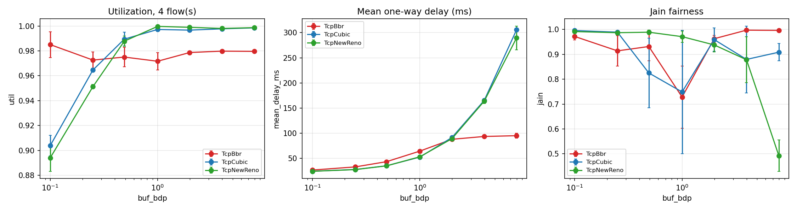
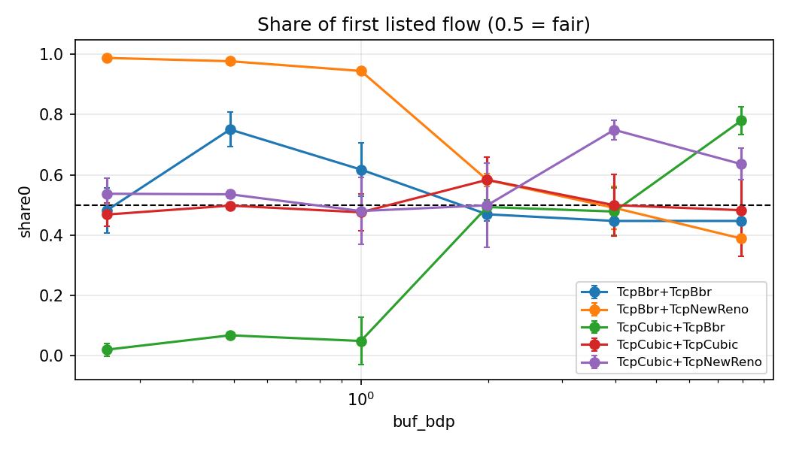
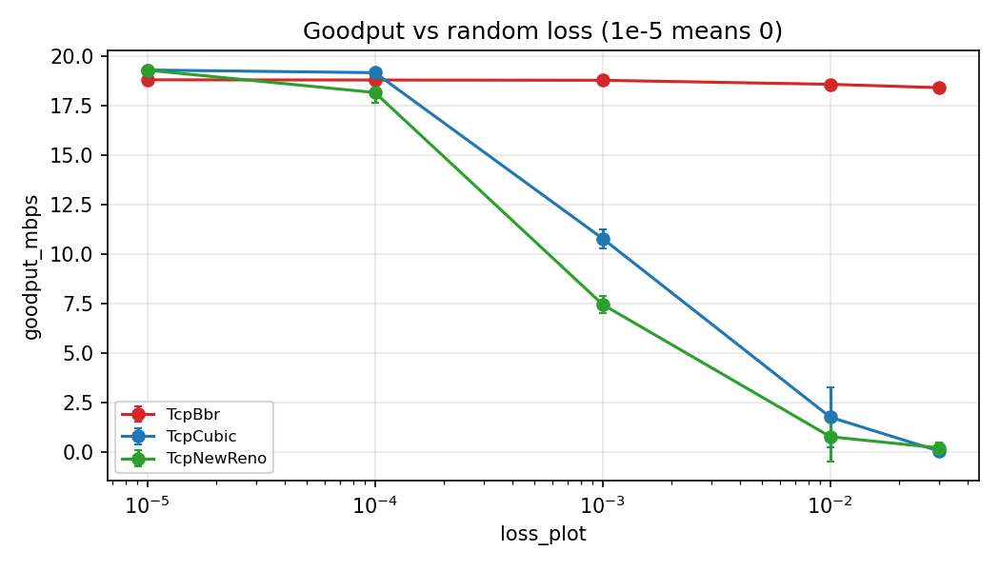

# ns-3 Network Simulation: Setup and TCP Congestion Control

## Overview

This project establishes an **ns-3.47** network-simulation environment and evaluates how TCP congestion-control algorithms behave under different network conditions. The work was carried out in an Ubuntu 24.04 ARM64 environment on an Apple M2 host using VMware Fusion.

The work covers environment setup (Part 1) and a TCP performance study (Part 7). The experiment suite contains **378 raw CSV result files** across five experiment groups.

## Setup and implementation

- Installed and built ns-3.47.
- Implemented the TCP comparison scenario in `scratch/cc-compare.cc`.
- Used `run_sweep.py` to run parameter sweeps and save raw CSV results.
- Used `plot_ns3.py` with pandas and Matplotlib to aggregate results and generate plots.
- Kept per-run CSVs and congestion-window/queue traces under `~/sim/results/ns3/`.

The baseline scenario uses a dumbbell topology with a **20 Mbps bottleneck**. The experiment suite varies buffer size, RTT, competing TCP variants, random packet loss, and queue discipline. The raw result files include metrics such as goodput, link utilization, mean one-way delay, Jain fairness, packet drops, and per-flow throughput.

## Results and observations

### 1. Buffer size changes the throughput–delay trade-off

For a single NewReno flow, increasing the buffer from **0.1 BDP to 7.96 BDP** raised reported mean one-way delay from **23.554 ms to 291.225 ms**. Utilization increased from **0.806 to approximately 1.0**, but the larger buffer came with much higher delay.

For a single BBR flow, utilization remained approximately **0.97–0.995** across the buffer sweep, while mean delay rose from **25.015 ms** to **56.806 ms**. In this simulation, BBR maintained high utilization with a smaller delay increase than NewReno at large buffers.



### 2. Coexisting TCP algorithms do not always share capacity equally

The coexistence experiment compares pairs of TCP variants. Its plot reports the share of throughput received by the first listed flow; **0.5 represents an even split** for two flows. The results vary with both the algorithm pairing and buffer size, so a single overall ranking would hide important differences.



### 3. Loss and queue management are separate performance dimensions

The random-loss experiment compares goodput as configured packet loss changes. The queue-management experiment compares FIFO, CoDel, and FQ-CoDel. These results should be interpreted using their dedicated plots, because the generated `summary.csv` groups by experiment, TCP variant, flow count, and buffer size but does **not** retain loss rate for E4 or queue discipline for E5. Consequently, the summary averages away variables that are central to those experiments.



## Limitations

- These are discrete-event simulation results, not measurements from a physical network.
- The reported `mean_delay_ms` is FlowMonitor mean one-way delay and includes startup behavior; it should not be described as pure queueing delay.
- Results depend on the selected topology, bottleneck settings, buffer sizes, queue discipline, random seed, and simulation duration.
- The aggregate summary omits some independent variables for E2, E4, and E5. Use raw CSV files or the dedicated plots for conclusions about RTT, loss rate, and queue discipline.

## Reproducibility

Key files:

- `scratch/cc-compare.cc` — simulation scenario
- `run_sweep.py` — experiment runner
- `plot_ns3.py` — result aggregation and plotting
- `results/ns3/raw/` — raw experiment CSVs
- `results/ns3/figs/` — generated figures and trace plots

To regenerate plots from existing raw data:

```bash
python3 ~/sim/ns3/plot_ns3.py
```

This regenerates the plots and overwrites `summary.csv`; preserve a copy first if the existing summary must be retained.
